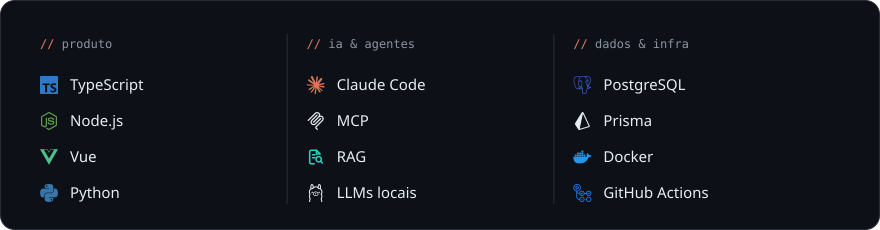

Desenvolvedor full stack. No dia a dia trabalho com **TypeScript**, **Node.js** e **Vue**, e uso agentes de IA no meu fluxo de desenvolvimento.

Desenvolvedor na **Sancon** · Engenharia de Computação na **Unoesc**

&nbsp;

